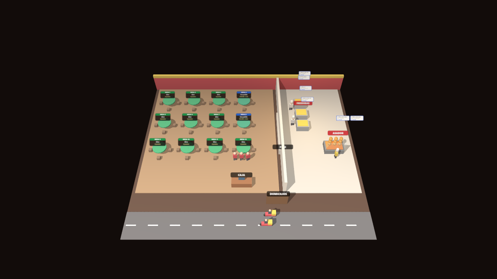

# Cocina 3D en vivo · Dashboard 3D para restaurantes (AppSheet + Apps Script + Three.js)

Gemelo digital en 3D de una cocina de pollo frito, alitas y pollo asado que se mueve con datos reales: lee la hoja de Google de una app de restaurante hecha en **AppSheet** y lo dibuja en el navegador con **Three.js** y **SVG**.



> 🎥 Tutorial completo en YouTube: [ENLACE_DEL_VIDEO]
>
> Homenaje de un fan a Frisby, marca nacida en Pereira (Eje Cafetero, Colombia). **Contenido independiente, no patrocinado ni afiliado a Frisby S.A.** Diseño 3D original; los productos tienen nombres de ejemplo. Sin logo, mascota, empaques ni recetas oficiales.

## Qué hace
- Mesas que cambian de color según su estado: libre, ocupada, con pedido o por cobrar.
- Comandas flotando sobre su estación (freidoras o asador) con un temporizador que pasa de azul a ámbar y a rojo.
- Muñecos (meseros y cocineros) y motos de domicilio animados con interpolación (lerp) y `requestAnimationFrame`.
- Indicadores en SVG: ventas del día, ticket promedio, tiempo de cocina, domicilios en ruta y lo más vendido.
- Clic en una mesa o comanda: detalle y enlace profundo a la cuenta dentro de AppSheet.
- Aviso cuando el bot de AppSheet genera el recibo PDF de una cuenta pagada.
- Solo lectura: nunca escribe en la hoja.

## Arquitectura
```
AppSheet → Google Sheet (única fuente) → Apps Script (doGet + getEstado → JSON) → index.html (Three.js + SVG)
```

## Archivos
| Archivo | Qué es |
|---|---|
| `Codigo.gs` | Servidor en Apps Script: lee la hoja y arma el JSON (`getEstado`). |
| `index.html` | Página web: escena 3D, indicadores SVG, refresco y clics. Trae un **modo demo** con datos simulados. |
| `docs/Documentacion_Tecnica.md` | Modelo de datos, escena, lógica estado → visual, refresco y conexión con el bot de PDF. |

## Instalación (5 minutos)
1. Entra a [script.google.com](https://script.google.com) → **Nuevo proyecto**.
2. Pega `Codigo.gs` en el archivo de código y crea un archivo HTML llamado `index` con el contenido de `index.html`.
3. En `CONFIG` (arriba de `Codigo.gs`) pon el ID de tu hoja, el ID y el nombre de tu app de AppSheet.
4. **Implementar → Nueva implementación → Aplicación web**, ejecutar como tú, y autoriza el acceso de lectura a la hoja.
5. Abre la URL `/exec`. Si quieres, ponla como botón en tu app de AppSheet.

¿Solo quieres verlo funcionar? Abre `index.html` directamente en el navegador: entra en modo demo con datos simulados.

## Tablas que lee
`Mesas`, `Carta`, `Cuentas`, `DetalleCuenta`, `Domicilios`, `Clientes`, `User` y `Config`. Las columnas exactas están en `docs/Documentacion_Tecnica.md`. Si tu app usa otros nombres, ajusta la función `construirEstado_`.

## Contacto
¿Quieres un tablero así o una app completa para tu negocio?
- WhatsApp: +34 613 499 977
- Instagram: [@setappsheet](https://instagram.com/setappsheet)

## Licencia
MIT. Úsalo, adáptalo y compártelo.
